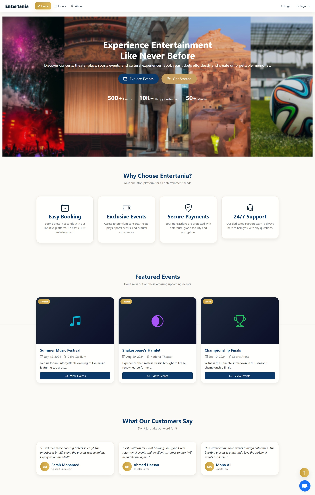
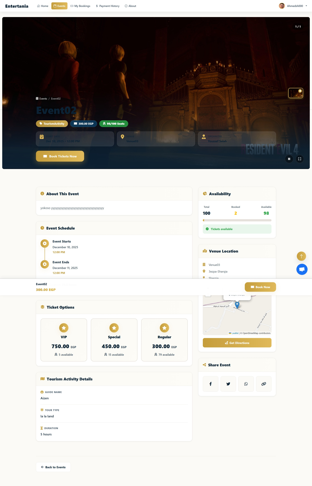
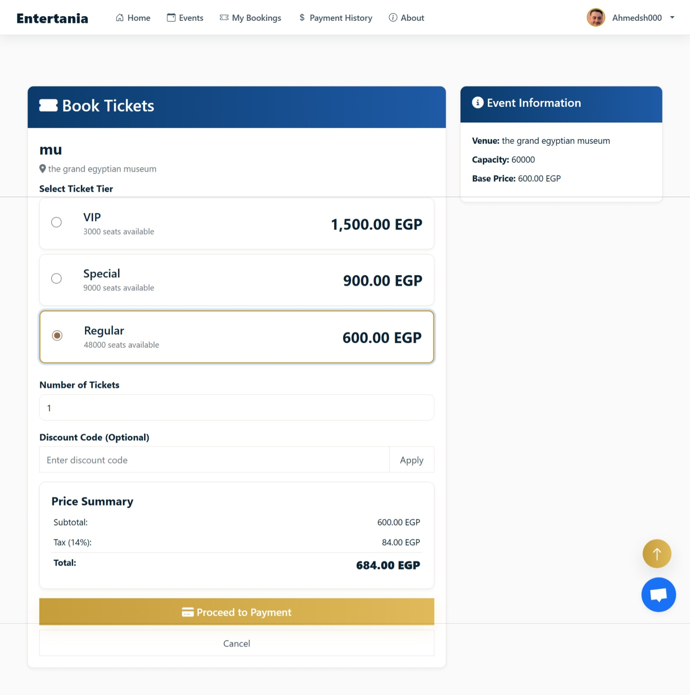
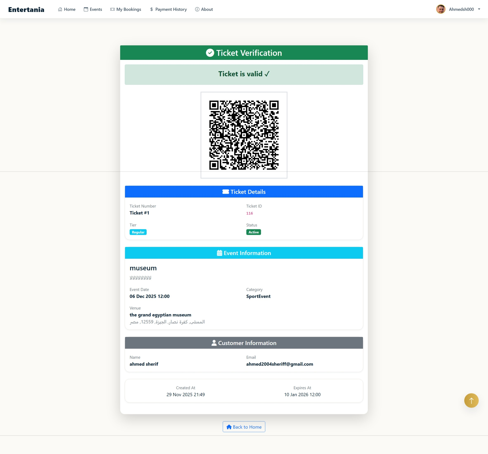
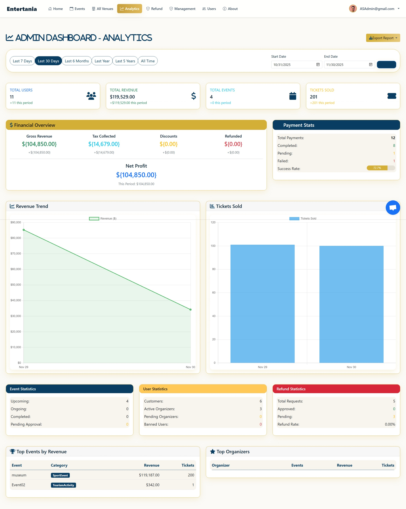
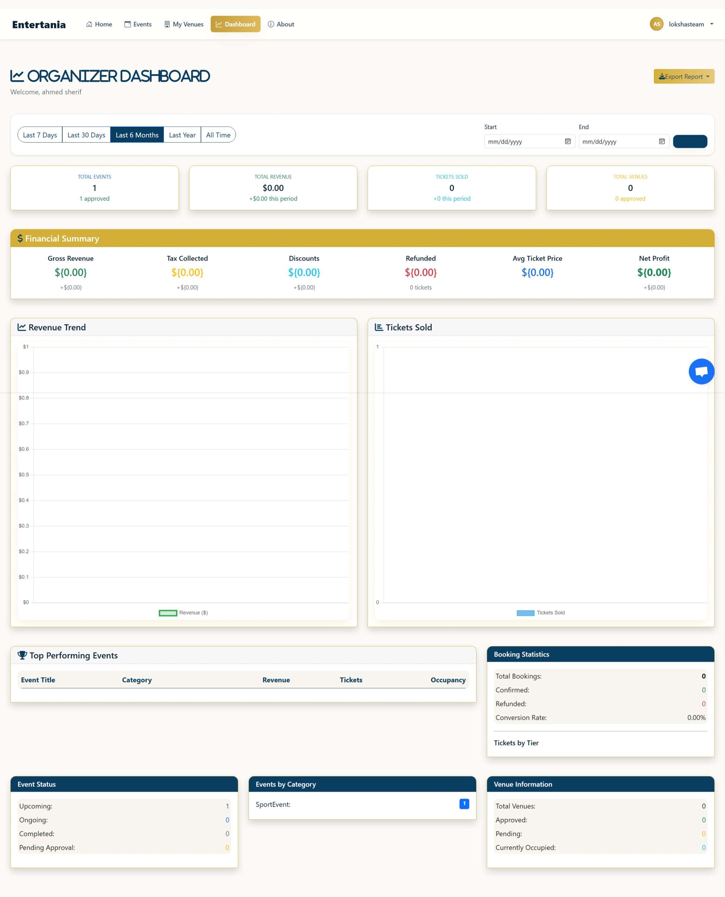

<h1 align="center">🎫 Entertainia — Event Management & Ticketing Platform</h1>

<p align="center">
  A full event lifecycle platform: organizers publish events and venues, customers book and pay online,
  and QR-coded tickets are issued and verified — live in production at
  <a href="http://entertainia.runasp.net"><strong>entertainia.runasp.net</strong></a>.<br>
  <em>Capstone project of the Digital Egypt Pioneers Initiative (DEPI) — built by a 2-person backend team.</em>
</p>

---

## Features

- **Event & venue management** across five event types — concerts, theater plays, sports events, cultural events, and tourism activities — with photo/video galleries and per-event ticket tiers.
- **Booking & ticketing** — QR-coded tickets (QRCoder) with verification hashes, PDF ticket generation (iText), booking flow backed by unit-of-work transactions.
- **End-to-end Paymob payment integration** — hosted iframe checkout, HMAC-verified callbacks/webhooks, automated order-state management, and a **refund pipeline** with configurable refund percentages.
- **Multi-role access** — Admin / Organizer / Customer via ASP.NET Identity with JWT tokens (plus cookie auth for the MVC UI) and custom authorization policies.
- **Transactional email** via SendGrid — confirmation codes, booking notifications; endpoint **rate limiting** on sensitive account operations.
- **Discount codes**, currency conversion (ExchangeRate API), reviews, soft-delete with query filters, and banned-email screening.
- **Background services** — abandoned-booking cleanup and expired-token cleanup.
- **Admin & organizer dashboards** with Excel exports (ClosedXML).
- Unit test suite (`Entertainia.Tests`, xUnit).

## Screenshots

| | |
|---|---|
|  |  |
|  |  |
|  |  |

## Architecture

Clean N-tier ASP.NET Core 8 MVC solution (folder names keep the original "Entertania" spelling):

```
EntertainiaSolution.sln
├── Core/               Domain models, options, repository & service interfaces
├── Infrastructure/     EF Core DbContext + migrations, repositories, Unit of Work,
│                       Identity/security, seed data
├── Service/            Business logic — bookings, payments, refunds, tickets,
│                       emails, dashboards, background services
├── Entertania1/        ASP.NET Core 8 MVC web app (controllers, views, view models)
└── Entertania.Tests/   xUnit test suite
```

**Stack:** C# · ASP.NET Core 8 MVC · Entity Framework Core 8 · SQL Server · ASP.NET Identity + JWT · SignalR · SendGrid · Paymob · QRCoder · iText · ClosedXML · AspNetCoreRateLimit

## Getting started

### Prerequisites

- .NET 8 SDK
- SQL Server (LocalDB/Express works for development)

### 1. Configure secrets

`appsettings.json` ships with **empty placeholders** — real values load from
[.NET User Secrets](https://learn.microsoft.com/aspnet/core/security/app-secrets) in Development.
From `Entertania1/`:

```powershell
cd Entertania1
dotnet user-secrets set "ConnectionStrings:DefaultConnection" "<your SQL Server connection string>"
dotnet user-secrets set "Jwt:SecretKey" "<random signing key, 48+ characters>"

# Seed admin accounts (add :1:, :2:, ... for more)
dotnet user-secrets set "AdminUsers:0:Email" "<admin email>"
dotnet user-secrets set "AdminUsers:0:UserName" "<admin username>"
dotnet user-secrets set "AdminUsers:0:Password" "<admin password>"

# Paymob (from your Paymob dashboard)
dotnet user-secrets set "Paymob:ApiKey" "<paymob api key>"
dotnet user-secrets set "Paymob:IntegrationId" "<integration id>"
dotnet user-secrets set "Paymob:IframeId" "<iframe id>"
dotnet user-secrets set "Paymob:HmacSecret" "<hmac secret>"

# SendGrid + exchange rates
dotnet user-secrets set "SendGridSettings:ApiKey" "<sendgrid api key>"
dotnet user-secrets set "ExchangeRateApi:ApiKey" "<exchangerate-api key>"
```

In production, provide the same keys as environment variables
(e.g. `ConnectionStrings__DefaultConnection`, `Paymob__ApiKey`).

### 2. Create the database

```powershell
dotnet ef database update --project Infrastructure --startup-project Entertania1
```

### 3. Run

```powershell
dotnet run --project Entertania1
```

Roles and the configured admin accounts are seeded on startup.

### Tests

```powershell
dotnet test
```

## Team

Built as the DEPI capstone by a two-person backend team. My part: Paymob payment & refund flow,
Identity + JWT multi-role auth, SendGrid transactional emails, discount-code validation, and
unit-of-work booking operations.

## License

Proprietary — see [LICENSE](LICENSE). No use, copying, or distribution without written permission.
